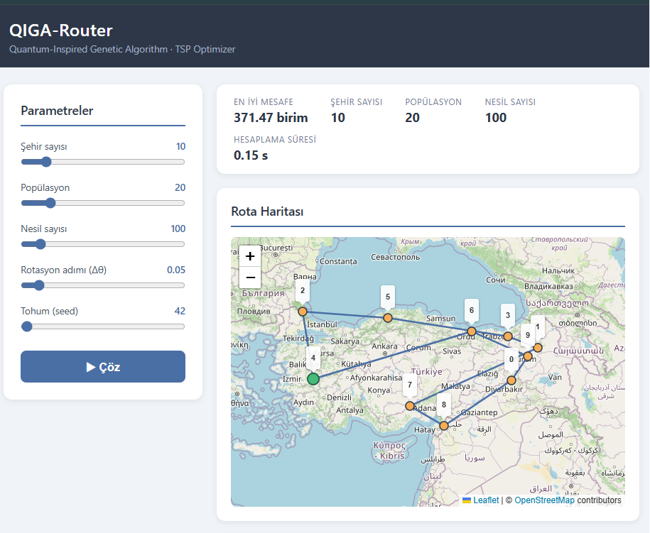
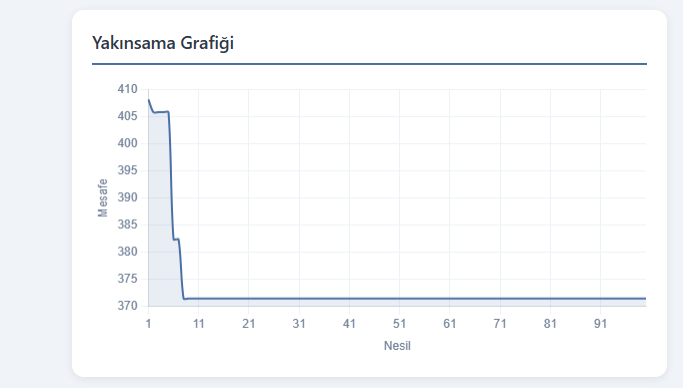

# QIGA-Router

**Quantum-Inspired Genetic Algorithm for the Travelling Salesman Problem**

A logistics route optimizer that solves the classic Travelling Salesman Problem (TSP)
using a Quantum-Inspired Evolutionary Algorithm (QIEA). No real quantum hardware is
used — the algorithm simulates qubit-encoded chromosomes and rotation gates inside a
classical genetic algorithm framework, following the approach of Han & Kim (2002).

Built as a portfolio project demonstrating end-to-end systems: algorithm core →
async REST API → interactive map UI.

| Map View | Convergence Chart |
|---|---|
|  |  |

---

## How It Works — QIGA vs Classical GA

A classical genetic algorithm encodes each individual as a fixed bit string (0 or 1).
QIGA instead represents each gene as a **probability angle θ ∈ [0, π/2]**:

```
cos²(θ)  →  probability of "visit this city early"
sin²(θ)  →  probability of "visit this city late"
```

Three concepts replace classical GA operators:

| Classical GA | QIGA equivalent | What it does |
|---|---|---|
| Chromosome | **Qubit chromosome** | θ vector — one angle per city |
| Initialization | θ = π/4 (**superposition**) | All cities equally likely, maximum uncertainty |
| Mutation | **Rotation gate** (Δθ) | Nudges θ toward the best known solution |
| Decoding | **Observation / collapse** | Samples θ into a concrete route permutation |

### Algorithm steps (each generation)

1. **Observe** — sample each qubit chromosome into a classical route via `argsort(sin²(θ))`
2. **Evaluate** — compute total Euclidean tour distance (fitness = distance to minimize)
3. **Elitism** — keep the global best route across all generations
4. **Rotate** — shift every chromosome's θ angles toward the global best by Δθ

As generations progress, θ values converge away from π/4, uncertainty collapses, and
the population concentrates around high-quality tours.

> Reference: Han, K. H., & Kim, J. H. (2002). *Quantum-inspired evolutionary algorithm
> for a class of combinatorial optimization.* IEEE Transactions on Evolutionary
> Computation, 6(6), 580–593.

---

## Architecture

Three independent layers communicate over HTTP:

```
QIGA-Router/
│
├── core/                   # Layer 1 — Algorithm (pure Python + NumPy)
│   ├── chromosome.py       #   QuantumChromosome: θ vector, observe(), rotate()
│   ├── distance.py         #   City generation, Euclidean distance matrix
│   ├── fitness.py          #   Tour distance, population evaluator
│   └── qiga.py             #   run_qiga() — main entry point, QIGAResult dataclass
│
├── api/                    # Layer 2 — REST API (FastAPI + Uvicorn)
│   ├── main.py             #   App factory, CORS, router registration
│   ├── models.py           #   Pydantic request/response schemas
│   └── routes/
│       ├── optimize.py     #   POST /api/v1/optimize — run QIGA
│       └── cities.py       #   GET  /api/v1/cities   — random city set
│
├── frontend/               # Layer 3 — Browser UI (React + Vite)
│   └── src/
│       ├── App.jsx         #   Root component, state management
│       ├── api/client.js   #   fetch wrapper for the REST API
│       └── components/
│           ├── ControlPanel.jsx   # Parameter sliders / inputs
│           ├── MapView.jsx        # React-Leaflet route map
│           ├── FitnessChart.jsx   # Chart.js convergence chart
│           └── ResultPanel.jsx    # Best distance + elapsed time
│
└── tests/                  # Pytest unit & integration tests
    ├── test_chromosome.py
    ├── test_distance.py
    ├── test_fitness.py
    ├── test_qiga.py
    └── test_api.py
```

---

## Technologies

| Layer | Stack |
|---|---|
| Algorithm core | Python 3.12, NumPy ≥ 1.26, SciPy ≥ 1.13 |
| REST API | FastAPI ≥ 0.111, Uvicorn, Pydantic v2 |
| Frontend | React 18, Vite 5, React-Leaflet 4, Chart.js 4 |
| Testing | Pytest ≥ 8.2, httpx (async API tests) |

---

## Installation & Setup

### Prerequisites

- Python 3.11+
- Node.js 18+

### Backend

```bash
# Clone and enter the project
git clone <repo-url>
cd QIGA-Router

# Create and activate a virtual environment
python -m venv venv

# Windows
venv\Scripts\activate

# macOS / Linux
source venv/bin/activate

# Install Python dependencies
pip install -r requirements.txt
```

Start the API server:

```bash
uvicorn api.main:app --reload
```

The API will be available at `http://127.0.0.1:8000`.  
Interactive docs: `http://127.0.0.1:8000/docs`

### Frontend

```bash
cd frontend
npm install
npm run dev
```

The UI will be available at `http://localhost:5173`.

> Make sure the backend is running before opening the frontend — the UI calls
> `http://127.0.0.1:8000/api/v1/optimize` on solve.

---

## Running Tests

```bash
# From the project root, with the venv activated
pytest -v
```

Expected output covers five test modules: `test_chromosome`, `test_distance`,
`test_fitness`, `test_qiga`, `test_api`.

---

## Algorithm Parameters

| Parameter | Default | Description |
|---|---|---|
| `n_cities` | `10` | Number of cities in the TSP instance. Higher values increase problem complexity exponentially. |
| `pop_size` | `20` | Number of qubit chromosomes in the population. Larger populations explore more of the search space per generation at the cost of compute time. |
| `n_generations` | `100` | Number of evolution cycles. More generations allow finer convergence but increase runtime linearly. |
| `delta` | `0.05` | Rotation gate step size (Δθ, radians). Small values (0.01–0.05) give fine-grained convergence; large values (> 0.1) risk premature convergence. |
| `seed` | `42` | Random seed for reproducibility. Controls both city placement and stochastic sampling. Omit for a random run. |

---

## API Quick Reference

```http
GET  /health                         # Liveness check
GET  /api/v1/cities?n=10&seed=42     # Generate a random city set
POST /api/v1/optimize                # Run QIGA and return the best route
```

**POST /api/v1/optimize — request body:**

```json
{
  "n_cities": 10,
  "pop_size": 20,
  "n_generations": 100,
  "delta": 0.05,
  "seed": 42
}
```

**Response:**

```json
{
  "best_route": [3, 7, 1, 0, 5, 9, 2, 8, 4, 6],
  "best_distance": 3.1416,
  "fitness_history": [4.2, 3.9, 3.5, "..."],
  "cities": [[0.37, 0.95], [0.73, 0.60], "..."]
}
```

---

## Roadmap

| Week | Goal | Status |
|---|---|---|
| 1 | Algorithm core — qubit chromosome, rotation gate, TSP fitness | Done |
| 2 | FastAPI layer — HTTP-triggered optimization, Pydantic schemas | Done |
| 3 | React frontend — Leaflet map, Chart.js convergence chart | Done |
| 4 | VRP extension (multi-vehicle), benchmark comparisons | Planned |

---

---

## Türkçe Özet

**QIGA-Router**, Gezgin Satıcı Problemi'ni (TSP) Kuantum-Esinli Evrimsel Algoritma
(QIEA) ile çözen bir lojistik optimizasyon sistemidir. Gerçek kuantum donanımı
kullanılmaz; algoritma, qubit-kodlu kromozomları ve rotasyon kapılarını klasik bir
genetik algoritma çerçevesinde simüle eder.

**Temel kavramlar:**

- **Qubit kromozomu** — her gen bir θ açısıyla temsil edilir. `cos²(θ)` şehrin erken,
  `sin²(θ)` ise geç ziyaret edilme olasılığını verir.
- **Süperpozisyon** — tüm bireyler `θ = π/4` ile başlar; maksimum belirsizlik, dengeli
  arama.
- **Rotasyon kapısı** — mutasyon eşdeğeri; θ'yı global en iyi çözüme doğru Δθ kadar
  döndürür.
- **Gözlem (collapse)** — `sin²(θ)` skoru üzerinden `argsort` ile geçerli bir TSP
  permütasyonu örneklenir.

**Katmanlar:** `core/` (NumPy algoritması) → `api/` (FastAPI) → `frontend/` (React +
React-Leaflet + Chart.js)

**Kurulum:**

```bash
pip install -r requirements.txt
uvicorn api.main:app --reload
```

```bash
cd frontend && npm install && npm run dev
```

**Testler:** `pytest -v`
